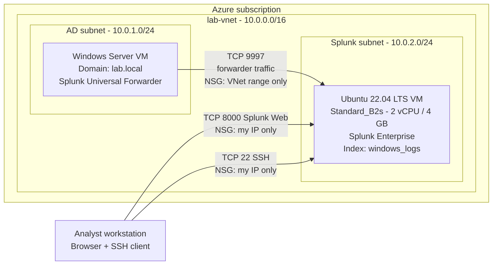
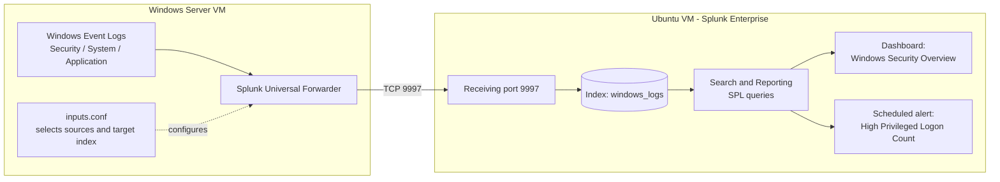

## Splunk SIEM & Log Analysis


> Deploy Splunk Enterprise on an Azure Linux VM, forward Windows Security, System and Application logs from the Active Directory server built in Lab 1, then search, visualise and alert on that data the way a SOC analyst would.

---
## Watch Me Build This Lab!

## Table of Contents

1. [Lab Summary](#lab-summary)
2. [Architecture](#architecture)
3. [The Problem This Lab Solves](#the-problem-this-lab-solves)
4. [Key Concepts](#key-concepts)
5. [Prerequisites](#prerequisites)
6. [Step 1 — Deploy Splunk on an Azure VM](#step-1--deploy-splunk-on-an-azure-vm)
7. [Step 2 — Configure Data Inputs](#step-2--configure-data-inputs)
8. [Step 2D — Generate Test Log Data](#step-2d--generate-test-log-data)
9. [Step 3 — Essential SPL Searches](#step-3--essential-spl-searches)
10. [Step 4 — Build a Security Dashboard](#step-4--build-a-security-dashboard)
11. [Step 5 — Create an Automated Alert](#step-5--create-an-automated-alert)
12. [Verification](#verification)
13. [Security Considerations](#security-considerations)
14. [Troubleshooting](#troubleshooting)
15. [Cleanup](#cleanup)
16. [Appendix — Additional Detection Queries](#appendix--additional-detection-queries)
17. [Skills Demonstrated](#skills-demonstrated)

---

## Lab Summary

| Field | Value |
|---|---|
| **Certification alignment** | CompTIA Security+ · CySA+ · Splunk Core Certified User |
| **Tools** | Splunk Enterprise (60-day trial, then Splunk Free at 500 MB/day), Splunk Universal Forwarder |
| **Platform** | Microsoft Azure — Ubuntu 22.04 LTS VM (indexer) + Windows Server VM from Lab 1 (log source) |
| **Time to complete** | 4–6 hours across multiple sessions |
| **Estimated cost** | $0 for Splunk licensing. Azure VM compute is billed while VMs run, so deallocate them when not in use |
| **Career relevance** | SOC Analyst (Tier 1–3) · Security Engineer · Incident Responder |

**Builds on:** Lab 1 — Active Directory. The Windows Server VM from that lab is the log source here.

---

## Architecture

### Environment and network flow



> The subnet layout above is the recommended design: one shared VNet with a subnet per lab, so no VNet peering is needed. The addresses are examples; substitute the private IPs shown in your own Azure portal.

### Log pipeline — from event to alert



### Network security group rules (Splunk VM)

| Priority | Name | Source | Port | Purpose |
|---|---|---|---|---|
| 300 | `Allow-SSH-MyIP` | My IP address | 22/TCP | Administration |
| 310 | `Allow-SplunkWebUI-MyIP` | My IP address | 8000/TCP | Splunk web interface |
| 320 | `Allow-SplunkForwarder-VNet` | Lab VNet range (e.g. `10.0.0.0/16`) or the Windows VM private IP | 9997/TCP | Log ingestion from the forwarder |

Nothing is exposed to the whole internet. Port 9997 is reachable only from inside the VNet.

---

## The Problem This Lab Solves

A medium-sized organisation generates millions of log events a day: Windows Event Logs, Active Directory authentication, firewall logs, web server access logs, and cloud resource logs. Without a SIEM, those logs sit in separate systems and nobody can search across them, correlate events, or spot the patterns that indicate an attack.

The SIEM is the security operations centre's primary tool. When an alert fires, the analyst searches the SIEM to find out what happened, when, from where, and what was affected. Splunk is the most widely deployed commercial SIEM, and the concepts transfer directly to Microsoft Sentinel and AWS Security Hub.

| Role | How this lab applies |
|---|---|
| SOC Analyst Tier 1 | Monitor dashboards, search logs for suspicious activity, escalate findings |
| SOC Analyst Tier 2–3 | Build detection rules, correlate events across sources, hunt for threats |
| Cloud Security Engineer | Same SIEM mental model as Microsoft Sentinel and AWS Security Hub |
| Incident Responder | Search logs during an incident, build a timeline, determine scope of compromise |

---

## Key Concepts

<details>
<summary><strong>SIEM — Security Information and Event Management</strong></summary>

A SIEM collects log data from across an environment and makes it searchable in one place. It does two core jobs: **correlation** (connecting events across systems to reveal patterns no single system would show) and **alerting** (notifying analysts automatically when suspicious conditions are met).
</details>

<details>
<summary><strong>SPL — Splunk Processing Language</strong></summary>

SPL is a pipeline language: find events first, then pipe them through commands that filter, transform and visualise. Example:

```spl
index=windows_logs EventCode=4624 | stats count by Account_Name | sort -count
```

This finds successful logon events, counts them per account, and sorts highest first.
</details>

<details>
<summary><strong>Index</strong></summary>

A named storage bucket for events, comparable to a database table. Separate indexes let you control retention, permissions and storage per data source. This lab creates one index, `windows_logs`.
</details>

<details>
<summary><strong>Universal Forwarder</strong></summary>

A lightweight, free Splunk agent installed on any machine whose logs you want to collect. It reads log files and Windows Event Logs, compresses the data, and forwards it to the indexer over port 9997. Here it runs on the Lab 1 Windows Server.
</details>

<details>
<summary><strong>Windows Event IDs used in this lab</strong></summary>

| EventCode | Meaning | Why it matters |
|---|---|---|
| 4624 | Successful logon | Authentication. Logon type distinguishes interactive, remote and service logons |
| 4625 | Failed logon | Brute force and password spray detection |
| 4672 | Special privileges assigned to a new logon | Admin-level logons |
| 4688 | New process created | Execution tracking and threat hunting |
| 4740 | Account locked out | Possible password spray in progress |
| 4648 | Logon with explicit credentials | Lateral movement and credential abuse (appendix) |
| 4697 | Service installed | Persistence mechanism (appendix) |
</details>

<details>
<summary><strong>inputs.conf</strong></summary>

The forwarder configuration file that defines what to collect. Each `[section]` is one data source. `disabled = 0` enables it, `start_from = oldest` collects historical events, and `index =` sets the destination index. Edit it, restart the forwarder once, and the changes apply.
</details>

---

## Prerequisites

- An Azure subscription
- The Windows Server VM from **Lab 1 — Active Directory**
- A free Splunk account (needed to download Splunk Enterprise and the Universal Forwarder)
- An SSH client: built-in `ssh` on macOS, Linux and current Windows, or PuTTY
- Basic comfort with a Linux terminal and PowerShell

**Splunk VM specification**

| Setting | Value |
|---|---|
| OS | Ubuntu 22.04 LTS |
| Size | Standard_B2s (2 vCPU, 4 GB RAM; Splunk needs at least 4 GB) |
| Disk | 30 GB minimum |
| Inbound NSG ports | 22 (my IP) · 8000 (my IP) · 9997 (VNet range only) |

---

## Step 1 — Deploy Splunk on an Azure VM

Running Splunk on an Azure VM keeps it available when your laptop is closed and lets the Windows VM send logs over the private Azure network.

### 1.1 Download Splunk Enterprise

1. Go to the [Splunk Enterprise download page](https://www.splunk.com/en_us/download/splunk-enterprise.html) and register for a free account.
2. Select **Splunk Enterprise** for Linux (`.deb`). Do not pick Splunk Cloud or Splunk SOAR.
3. Copy the `wget` command shown on the download page. Use that rather than any hard-coded URL, because Splunk retires old version links.

The 60-day trial converts automatically to the free licence, which allows 500 MB/day of indexing. That is plenty for a lab.

### 1.2 Create the VM and NSG rules

Create the Ubuntu VM with the specification above, in the same VNet as the Lab 1 server (a separate subnet). Then add the inbound rules from the [NSG table](#network-security-group-rules-splunk-vm).

Set the VM's public IP assignment to **Static** (VM → Public IP address → Configuration). Azure otherwise reassigns the IP whenever the VM is stopped and started, which breaks bookmarks and NSG rules.

### 1.3 Connect over SSH

```bash
# Azure key files arrive with permissions that are too open; SSH refuses them
chmod 400 yourkey.pem

ssh -i yourkey.pem <admin-username>@<VM_PUBLIC_IP>
```

Replace `<admin-username>` with the admin user you set when creating the VM, and `<VM_PUBLIC_IP>` with the address from the Azure portal. If you skip `chmod`, you will see an `UNPROTECTED PRIVATE KEY FILE` warning and the connection will be denied.

On Windows with PuTTY: enter the public IP, leave port 22 and connection type SSH, and click **Open**. If you authenticate with a password, nothing is echoed as you type; that is normal.

### 1.4 Install and start Splunk

```bash
# 1. Download the installer (use the current command from the Splunk download page)
wget -O splunk-10.2.2-linux-amd64.deb "https://download.splunk.com/products/splunk/releases/10.2.2/linux/splunk-10.2.2-80b90d638de6-linux-amd64.deb"

# 2. Install into /opt/splunk
sudo dpkg -i splunk-10.2.2-linux-amd64.deb

# 3. First start: accept the licence and create the admin account when prompted
sudo /opt/splunk/bin/splunk start --accept-license --run-as-root

# 4. Start Splunk automatically on every boot
sudo /opt/splunk/bin/splunk enable boot-start
```

| Command | What it does |
|---|---|
| `wget -O` | Downloads the `.deb` package and saves it under a clean filename |
| `dpkg -i` | Installs the package into `/opt/splunk` (a missing Python 3.7 path warning is harmless; Splunk 10.x ships its own Python) |
| `splunk start --accept-license --run-as-root` | Starts Splunk and prompts you to create the admin credentials used for the web UI |
| `splunk enable boot-start` | Registers Splunk as a service so it survives reboots |

### 1.5 Open the web UI

```
http://<VM_PUBLIC_IP>:8000
```

Log in with the admin account you created. If the page does not load, see [Troubleshooting](#troubleshooting).

---

## Step 2 — Configure Data Inputs

### Part A — Enable receiving in Splunk

Do this **before** installing the forwarder so the indexer is already listening.

1. **Settings → Forwarding and receiving → Configure receiving → New Receiving Port**, enter `9997`, and save.
2. **Settings → Indexes → New Index**, name it `windows_logs`, and save.

### Part B — Install the Universal Forwarder on the Windows Server

Perform this on the **Windows Server VM from Lab 1**, not on the Ubuntu VM.

1. Download the **Windows 64-bit** `.msi` from the [Universal Forwarder download page](https://www.splunk.com/en_us/download/universal-forwarder.html), signed in with your Splunk account.
2. Run the installer and choose **An on-premises Splunk Enterprise instance**. Do not choose Splunk Cloud, because that option skips the Receiving Indexer screen and the forwarder has nowhere to send data.
3. Create a local forwarder admin account (username `admin`, a password you record). You need it later for CLI commands.
4. **Deployment Server:** leave blank. Entering your Splunk VM here sends the forwarder to the wrong place and no data flows.
5. **Receiving Indexer:** enter the Splunk VM's **private** IP and port `9997` (for example `10.0.2.4:9997`).
6. Finish the install with default settings.

### Part C — Configure `inputs.conf`

Create this file on the Windows Server VM at:

```
C:\Program Files\SplunkUniversalForwarder\etc\system\local\inputs.conf
```

Create the `local` folder if it does not exist. Edit as Administrator (for example, VS Code launched with **Run as administrator**) so the file can be saved under Program Files.

```ini
[WinEventLog://Security]
# Authentication events: logons, failures, lockouts
disabled = 0
start_from = oldest
current_only = 0
# Resolve Active Directory objects so usernames appear instead of SIDs
evt_resolve_ad_obj = 1
# Without this line data goes to the default "main" index
index = windows_logs

[WinEventLog://System]
# OS-level events: service start/stop, driver failures
disabled = 0
index = windows_logs

[WinEventLog://Application]
# Events from installed applications
disabled = 0
index = windows_logs
```

Apply the change from PowerShell as Administrator:

```powershell
Restart-Service SplunkForwarder
```

---

## Step 2D — Generate Test Log Data

A fresh Windows Server has very little in its event logs. This script simulates failed logons, a successful logon, service restarts, application warnings and an account lockout attempt, so the searches in Step 3 have something to find.

It creates a temporary local user `labtest.user`, generates activity against it, and deletes it. Nothing is installed or permanently changed. Run it once, as Administrator, on the Windows Server VM (about 60–90 seconds).

> **Lab use only.** The script contains throwaway test credentials. Do not reuse patterns like this on a production system.

<details>
<summary><strong>Show the log generator script (PowerShell)</strong></summary>

```powershell
# Lab 3 Log Generator - run as Administrator on the Windows VM
# Output saved to C:\lab3-log-output.txt

$logFile = 'C:\lab3-log-output.txt'

function Log($message, $color = 'White') {
    $ts = Get-Date -Format 'yyyy-MM-dd HH:mm:ss'
    Write-Host $message -ForegroundColor $color
    Add-Content -Path $logFile -Value "[$ts] $message"
}

if (Test-Path $logFile) { Remove-Item $logFile }
Add-Content -Path $logFile -Value "Lab 3 Log Generator - run started at $(Get-Date -Format 'yyyy-MM-dd HH:mm:ss')"
Add-Content -Path $logFile -Value '============================================='

Log 'Starting log generation...' Green

# Create a temporary test user
$testUser = 'labtest.user'
$testPass = ConvertTo-SecureString 'TempPass123!' -AsPlainText -Force
New-LocalUser -Name $testUser -Password $testPass -Description 'Splunk lab test account' -ErrorAction SilentlyContinue
Log "Created test user: $testUser" Gray

# Failed logon attempts (Security log activity)
Log 'Generating failed logon attempts...' Yellow
$wrongPass = ConvertTo-SecureString 'WrongPassword!' -AsPlainText -Force
1..15 | ForEach-Object {
    $cred = New-Object System.Management.Automation.PSCredential($testUser, $wrongPass)
    Start-Process -FilePath 'cmd.exe' -Credential $cred -ArgumentList '/c exit' -ErrorAction SilentlyContinue
    Start-Sleep -Milliseconds 500
}
Log '  Generated 15 failed logon attempts' Gray

# Successful logon (Event ID 4624)
Log 'Generating successful logon (4624)...' Yellow
$correctPass = ConvertTo-SecureString 'TempPass123!' -AsPlainText -Force
$cred = New-Object System.Management.Automation.PSCredential($testUser, $correctPass)
Start-Process -FilePath 'cmd.exe' -Credential $cred -ArgumentList '/c whoami' -Wait -ErrorAction SilentlyContinue
Log '  Generated successful logon (4624)' Gray

# Service stop/start events (Event ID 7036)
Log 'Generating service events (7036)...' Yellow
@('Spooler','Schedule','Netlogon') | ForEach-Object {
    Stop-Service -Name $_ -Force -ErrorAction SilentlyContinue
    Start-Sleep -Seconds 2
    Start-Service -Name $_ -ErrorAction SilentlyContinue
    Start-Sleep -Seconds 1
    Log "  Stopped and restarted service: $_" Gray
}

# Application log entries
Log 'Generating application log events...' Yellow
$eventSource = 'SplunkLabTest'
if (-not [System.Diagnostics.EventLog]::SourceExists($eventSource)) {
    New-EventLog -LogName Application -Source $eventSource -ErrorAction SilentlyContinue
}
1..5 | ForEach-Object {
    Write-EventLog -LogName Application -Source $eventSource -EventId 1001 `
        -EntryType Warning -Message 'Splunk lab test event - application warning'
    Start-Sleep -Milliseconds 300
}
Log '  Generated 5 application log entries (Event ID 1001)' Gray

# Repeated bad passwords to trigger lockout (Event ID 4740)
Log 'Generating lockout attempts (4740)...' Yellow
$badCred = ConvertTo-SecureString 'BadPass!' -AsPlainText -Force
1..20 | ForEach-Object {
    $cred = New-Object System.Management.Automation.PSCredential($testUser, $badCred)
    Start-Process -FilePath 'cmd.exe' -Credential $cred -ArgumentList '/c exit' -ErrorAction SilentlyContinue
    Start-Sleep -Milliseconds 200
}
Log '  Lockout attempts complete' Gray

# Clean up
Start-Sleep -Seconds 3
Remove-LocalUser -Name $testUser -ErrorAction SilentlyContinue
Log "Removed test user: $testUser" Gray

# Ship the events
Log 'Restarting forwarder...' Yellow
Restart-Service SplunkForwarder -ErrorAction SilentlyContinue
Log '  SplunkForwarder restarted' Gray

Add-Content -Path $logFile -Value '============================================='
Add-Content -Path $logFile -Value "Run completed at $(Get-Date -Format 'yyyy-MM-dd HH:mm:ss')"
Write-Host 'Done. Output saved to C:\lab3-log-output.txt. Wait 60 seconds, then search Splunk.' -ForegroundColor Green
```

</details>

> **Note on 4740 (lockout):** an account only locks out if an account lockout threshold is configured. On a default local policy the threshold is `0` (never lock out), so you may see repeated 4625 failures but no 4740 event. Set a threshold under *Local Security Policy → Account Policies → Account Lockout Policy* (or via Group Policy in the domain) if you want to see 4740.

Wait 60 seconds, set the Splunk time range to **All time**, and run:

```spl
index=windows_logs | head 100
```

You should see events from the Security, System and Application logs.

---

## Step 3 — Essential SPL Searches

Run these in **Search & Reporting**, using the time picker at the right of the search bar.

### Confirm data is flowing

```spl
index=windows_logs | head 100
```

| Part | Meaning |
|---|---|
| `index=windows_logs` | Search only the index created in Step 2 |
| `\| head 100` | Return the first 100 events |

No results? Check that the `SplunkForwarder` service is running on the Windows VM.

### Successful logons (EventCode 4624)

```spl
index=windows_logs sourcetype=WinEventLog:Security EventCode=4624
| stats count by Account_Name
| sort -count
```

Counts successful logons per account. Accounts ending in `$` are computer accounts and are normal.

### Failed logons (EventCode 4625)

```spl
index=windows_logs sourcetype=WinEventLog:Security EventCode=4625
| stats count by Account_Name, Source_Network_Address
| sort -count
```

Failed logons per account and source. A handful is user error; many failures from one source, or one failure each across many accounts, suggests brute force or password spray.

### Account lockouts (EventCode 4740)

```spl
index=windows_logs sourcetype=WinEventLog:Security EventCode=4740
| table _time, Account_Name, Caller_Computer_Name
| sort -_time
```

A trail of lockouts across multiple accounts in a short window is a classic password spray indicator. Requires a lockout policy (see the note in Step 2D).

### After-hours logons

```spl
index=windows_logs sourcetype=WinEventLog:Security EventCode=4624
| eval hour=strftime(_time, "%H")
| where hour < 7 OR hour > 19
| table _time, Account_Name, Account_Domain, ComputerName
| sort -_time
```

| Part | Meaning |
|---|---|
| `eval hour=strftime(_time, "%H")` | Extracts the hour from each event timestamp |
| `where hour < 7 OR hour > 19` | Keeps only events outside 07:00–19:59 |

Human accounts (no trailing `$`) logging in after hours warrant review.

---

## Step 4 — Build a Security Dashboard

1. Open **Dashboards → Create New Dashboard**.
2. Title: `Windows Security Overview`. Permissions: Private. Type: **Classic Dashboards**. Click **Create**.
3. For each panel below: **Add Panel → New Search**, paste the search, choose the visualisation, and save.

**Panel 1 — Account Activity (last 24h)** · Bar chart

```spl
index=windows_logs sourcetype=WinEventLog:Security EventCode=4624
| stats count by Account_Name
| sort -count
```

**Panel 2 — Top Processes (last 24h)** · Events list

```spl
index=windows_logs sourcetype=WinEventLog:Security EventCode=4688
| stats count by Creator_Process_Name
| sort -count
| head 20
```

**Panel 3 — Login Activity Over Time** · Line chart

```spl
index=windows_logs sourcetype=WinEventLog:Security EventCode=4624
| timechart count
```

**Panel 4 — After-Hours Logins** · Events list

```spl
index=windows_logs sourcetype=WinEventLog:Security EventCode=4624
| eval hour=strftime(_time, "%H")
| where hour < 7 OR hour > 19
| table _time, Account_Name, Account_Domain, ComputerName
| sort -_time
```

> Panel 2 depends on 4688 events, which Windows only logs when **Audit Process Creation** is enabled (*Advanced Audit Policy → Detailed Tracking*). If the panel is empty, enable that audit policy first.

---

## Step 5 — Create an Automated Alert

Alerts turn a search into automated detection: Splunk runs it on a schedule and records a trigger when the conditions are met.

First, confirm the search works:

```spl
index=windows_logs sourcetype=WinEventLog:Security EventCode=4672
| stats count as privilege_logons by Account_Name, ComputerName
| where privilege_logons > 50
```

This finds any account with more than 50 privileged logon events. Event 4672 fires when admin-level rights are assigned at logon.

Then **Save As → Alert** with these settings:

| Setting | Value |
|---|---|
| Name | `High Privileged Logon Count` |
| Alert type | Scheduled |
| Schedule | Cron: `*/15 * * * *` (every 15 minutes) |
| Trigger condition | Number of results is greater than `0` |
| Trigger action | Add to Triggered Alerts |

**Add to Triggered Alerts** writes each firing, with timestamp and result count, to **Activity → Triggered Alerts**. It needs no external system such as email or a ticketing tool.

**Tuning matters.** An alert that fires too broadly causes alert fatigue and analysts stop paying attention; one that is too narrow misses real threats. The threshold of 50 here is a starting point. In a real environment you would tune it against observed false positives over time.

---

## Verification

| Check | How to verify | Result |
|---|---|---|
| Data is flowing | `index=windows_logs \| head 10` returns recent events | ☐ |
| Login search works | The EventCode 4624 search returns results | ☐ |
| Dashboard displays data | *Windows Security Overview* shows populated panels | ☐ |
| Alert is active | **Settings → Searches, reports, and alerts** lists the alert as Enabled | ☐ |

### Screenshots

<!-- Add your own screenshots to docs/images/ using these filenames, or edit the paths below. -->

| Evidence | Screenshot |
|---|---|
| Events arriving in `windows_logs` |  |
| Windows Security Overview dashboard |  |
| Alert configuration |  |

---

## Security Considerations

Choices made in this lab, and what to change before applying them in production.

| Area | In this lab | In production |
|---|---|---|
| **Network exposure** | SSH (22) and Splunk Web (8000) restricted to my IP; 9997 restricted to the VNet | Put management access behind a VPN or Azure Bastion; avoid public IPs on the indexer entirely |
| **Splunk Web transport** | Plain HTTP on port 8000 | Enable HTTPS for Splunk Web, ideally with a trusted certificate |
| **Forwarder traffic** | Plain TCP 9997 inside the private VNet | Enable TLS between forwarders and indexers |
| **Authentication** | Local Splunk `admin` account | SSO/SAML or LDAP, role-based access, MFA, no shared admin accounts |
| **Credentials** | Throwaway test credentials in the generator script | Never embed credentials in scripts; use a secrets manager |
| **Index design** | One index for all Windows data | Separate indexes per data source to control retention and permissions |
| **Capacity** | Splunk Free, 500 MB/day, single instance | Licensed deployment with sizing, retention and high-availability planning |
| **Detection quality** | Fixed threshold of 50 | Tune thresholds against baseline behaviour; track false-positive rate |
| **Audit coverage** | Default Windows audit policy plus what the lab needs | Deliberate Advanced Audit Policy so 4625, 4688, 4697 and others are actually logged |

Splunk Free has no authentication or role-based access control features in the way a licensed deployment does, so treat it strictly as a lab tool and keep it off the open internet.

---

## Troubleshooting

### "This site can't be reached" on port 8000

Work through these in order.

1. **NSG rule for 8000.** Azure portal → Splunk VM → **Networking → Inbound port rules**. If missing, add: Name `Allow-SplunkWebUI-MyIP`, Source *My IP address*, Destination port `8000`, TCP, Allow, Priority `310`. This fixes most cases.
2. **Splunk running?**
   ```bash
   sudo /opt/splunk/bin/splunk status
   # Expected: splunkd is running
   ```
   If stopped: `sudo /opt/splunk/bin/splunk start --accept-license --run-as-root`
3. **Listening on 8000?**
   ```bash
   sudo ss -tlnp | grep 8000
   # Expected: 0.0.0.0:8000 with splunkd in the process column
   ```
   No output means Splunk is not running. Output present means the problem is the NSG rule.
4. **Correct public IP?** Azure can reassign a dynamic public IP after a stop/start. Always read the current IP from the VM Overview page, or set it to Static.

### No data arriving in Splunk

5. **NSG rule for 9997.** On the Splunk VM's NSG add `Allow-SplunkForwarder-VNet` (or `Allow-SplunkForwarder-WindowsVM` with the Windows VM's private IP as source), port `9997`, TCP, Allow, Priority `320`.
6. **VMs in different VNets?** NSG rules alone are not enough; the VNets must be peered.
   - Azure portal → **Virtual networks** → the Splunk VM's VNet → **Peerings → Add**
   - This VNet peering link name: `splunk-vnet-to-ad-vnet`; Remote link name: `ad-vnet-to-splunk-vnet`
   - Remote virtual network: the Windows Server VM's VNet; leave other settings default
   - Wait until both links show **Connected**, then on the Windows VM run `Restart-Service SplunkForwarder` in an elevated PowerShell

   Avoiding this entirely is better: put all lab VMs in one VNet with a subnet per lab.
7. **Forwarder misconfigured.** Confirm the Deployment Server field was left blank and the Receiving Indexer is `<Splunk private IP>:9997`. Confirm each `inputs.conf` stanza has `index = windows_logs`, then restart the forwarder.
8. **Receiving not enabled.** Confirm port 9997 is listed under **Settings → Forwarding and receiving → Configure receiving**.
9. **Wrong time range.** Set the Splunk time picker to **All time** when testing.

---

## Cleanup

Azure bills for compute while VMs are running.

- **Between sessions:** *Stop* each VM from the Azure portal so it is **deallocated** (shutting down from inside the OS is not enough to stop compute billing). With a static public IP the address stays the same.
- **When finished with the lab:** delete the resource group that holds the lab resources.
- Remove the `labtest.user` account if the generator script did not complete.

---

## Appendix — Additional Detection Queries

These require event types that a fresh lab VM may not produce. They are reference material for a longer-running or more active environment and are not required to complete the lab.

### Logon with explicit credentials (EventCode 4648)

Fires when credentials are passed explicitly, for example with `runas`. Rare in normal operation; a cluster of them is a common sign of lateral movement or credential abuse.

```spl
index=windows_logs sourcetype=WinEventLog:Security EventCode=4648
| table _time, Account_Name, Target_Server_Name, Process_Name
| sort -_time
```

Legitimate sources include scheduled tasks, backup agents and some admin tools. Suspicious sources include lateral movement, pass-the-hash and credential stuffing.

### Process creation (EventCode 4688)

Fires whenever a process launches. Malware, ransomware and attackers all have to run processes, so this is foundational for endpoint threat hunting.

```spl
index=windows_logs sourcetype=WinEventLog:Security EventCode=4688
| stats count by Creator_Process_Name
| sort -count
| head 20
```

Processes run from temp folders or `AppData`, and `cmd.exe` or `powershell.exe` spawned by unexpected parents, are red flags. Requires Audit Process Creation to be enabled.

### Service installation (EventCode 4697)

Fires when a new service is installed. Services run with elevated privileges and persist across reboots, which makes them a favoured persistence mechanism.

```spl
index=windows_logs sourcetype=WinEventLog:Security EventCode=4697
| table _time, Account_Name, Service_Name, Service_File_Name
| sort -_time
```

Random or obfuscated service names, and executables in temp directories, are indicators of malware. Cross-reference `Account_Name` to see who installed the service.

---

## Skills Demonstrated

| Skill | Real-world application |
|---|---|
| Deploy Splunk and configure a data input | Every Splunk deployment starts with getting data in; the Universal Forwarder is how most enterprises feed it |
| Cloud network design | Subnet layout, NSG least-privilege rules, VNet peering |
| Navigate the Splunk interface | Search, dashboards, alerts and reports are table stakes for any SOC role |
| Write SPL searches | The skill that separates analysts who find threats from analysts who watch dashboards |
| Build security dashboards | Login activity over time, account activity, after-hours authentication |
| Identify failed logons | Distinguishing user error from brute force |
| Detect lockout patterns | A trail of lockouts can indicate password spray |
| Build an automated alert | Scheduled detection instead of waiting for a human to notice |

---

*Part of a hands-on cloud security lab series. Previous: Lab 1 — Active Directory, Lab 2 — Wireshark & Network Analysis.*
